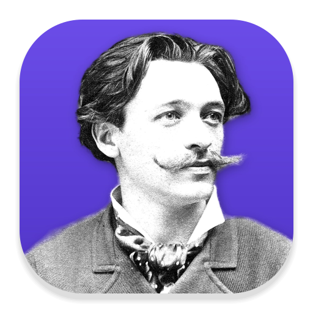
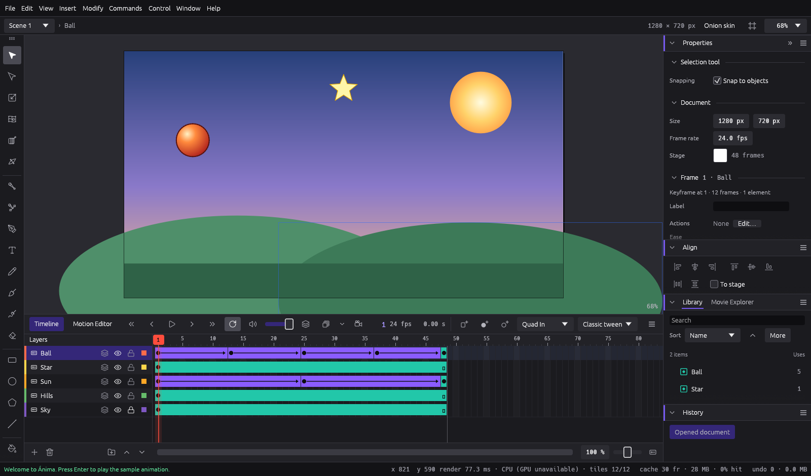
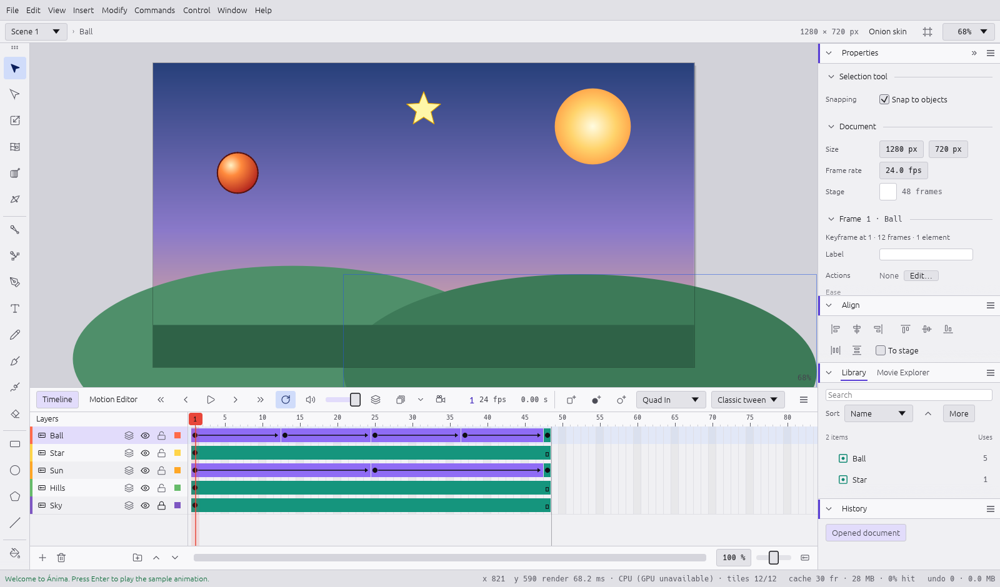

<div align="center">
  <a href="https://getnodalia.com">
    
  </a>
  <br><br>
  
  <h1>Ánima</h1>
  <p><strong>The 2D animation app of the Nodalia suite.</strong></p>

  <p>
    
    
    
  </p>

  <p>
    <a href="#screenshots">Screenshots</a> ·
    <a href="#what-it-does">What it does</a> ·
    <a href="#platforms-and-downloads">Download</a> ·
    <a href="#build-and-run">Build</a> ·
    <a href="#agents-and-the-command-line">Agents</a> ·
    <a href="#how-it-is-built">Architecture</a> ·
    <a href="#license">License</a>
  </p>
</div>

<p align="center">
  
  <br><sub><b>The sample animation</b> in the dark theme: stage, tools, timeline with classic tweens, Properties and Library.</sub>
</p>

---

## Overview

**Ánima** is the 2D animation app of [Nodalia](https://getnodalia.com): vector drawing, a frame
timeline with layers and keyframes, tweens, symbols and onion skin, for character animation,
motion graphics, banners and short films. It is a native app written in Rust, with no account and
no cloud, and it runs on Linux, macOS, Windows and FreeBSD, and in the browser through
WebAssembly. It opens Adobe Animate documents (`.fla`, `.xfl`), and every action is a command that
scripts and agents can run too.

> [!IMPORTANT]
> **Ánima is at an early stage.** Expect rough edges, and keep a copy of work that matters.
> [docs/roadmap.md](docs/roadmap.md) has the honest status, area by area.

## Screenshots

<table>
  <tr>
    <td width="50%"></td>
    <td width="50%"></td>
  </tr>
  <tr>
    <td><sub><b>Light theme</b>: the theme is chosen in Preferences.</sub></td>
    <td><sub><b>Made in Ánima</b>: the sample animation, exported as an animated GIF from the command line (<code>anima-cli gif --sample --out sample.gif --scale 0.5</code>).</sub></td>
  </tr>
</table>

## What it does

- **Drawing.** Selection and Subselection with Bézier anchors and handles, Pen, Pencil with curve
  fitting, Brush, Eraser, Rectangle with corner radii, Oval, PolyStar, Line and Text. Shapes on a
  layer merge and cut each other, or stay separate with Object Drawing.
- **Colour.** Paint Bucket with gap closing, Ink Bottle, solid colours, linear and radial
  gradients, bitmap fills, stroke styles and swatches.
- **Timeline.** Normal, guide, motion-guide and mask layers and layer folders; keyframes, blank
  keyframes and frame spans you drag; multi-frame selection across layers; onion skin.
- **Animation.** Classic tweens with easing presets and custom ease curves, shape tweens between
  any contours, motion paths, bones, camera, symbols with their own timelines (graphic symbols,
  movie clips, buttons), filters, blend modes and scenes.
- **Sound and interactivity.** Audio layers with waveforms and envelopes; frame scripts that
  control the timeline, tried in Test Movie.
- **Files.** Its own `.anima` documents (JSON, documented); opens `.fla`, `.xfl` and XFL folders
  and imports SVG. Exports PNG frames and sequences, animated GIF and WebP, SVG frames, sprite
  sheets, Lottie and HTML, and WebM or MP4 through an ffmpeg you install.
- **Your way of working.** Workspaces (Essentials, Animator, Designer), docking panels, a command
  palette (`Ctrl+K`), a shortcut editor (`F1`), crash recovery, a user guide that opens offline
  from **Help › User Guide**, plug-ins in WebAssembly, and screen reader and high-contrast
  support.
- **Updates from the app.** Ánima can tell you when a new version is out and install it for you.

The full list of what works, and what does not yet, is in [docs/roadmap.md](docs/roadmap.md).

## Platforms and downloads

Ánima has not published a release yet. The first one will appear on the
[releases page](https://github.com/getnodalia/anima/releases) with these packages, built in CI:

| System | Package |
|---|---|
| Linux x86_64 | `.AppImage`, `.deb` (Debian, Ubuntu), `.rpm` (Fedora, openSUSE) and `.tar.gz` |
| macOS (Apple silicon and Intel) | `.dmg`, plus the command-line tool as a `.zip` |
| Windows x64 | `.msi` installer and a portable `.zip` |

The macOS DMG will not be signed: the first time, right-click Ánima in Applications, choose
**Open** and confirm. Until then, build it from source; it also builds on FreeBSD and for the web
([docs/web.md](docs/web.md)).

## Build and run

You need Rust 1.95 or later.

```bash
git clone https://github.com/getnodalia/anima.git
cd anima
cargo run --release                     # the app, with the sample animation
cargo run --release -- my-film.anima    # or a document of yours
```

Linux needs the usual windowing and audio headers (Debian and Ubuntu: `libxkbcommon-dev
libwayland-dev libx11-dev libxrandr-dev libxi-dev libgl1-mesa-dev libgtk-3-dev libasound2-dev`).
The interface font (Inter) comes from the optional `CRAFT_FONTS_DIR` build input, a checkout of
[getnodalia/foundation's `vendor/craft-fonts/main`](https://github.com/getnodalia/foundation/tree/vendor/craft-fonts/main)
branch; without it Ánima uses egui's built-in fonts. Setup, tests and build hygiene are in
[docs/development.md](docs/development.md).

## Agents and the command line

Every menu item and tool is a command, so scripts and agents can do anything a person can:

```bash
anima-cli info --sample
anima-cli render --sample --frame 12 --out frame12.png
anima-cli gif --sample --out animation.gif
anima-cli exec --sample draw.rect '{"x":10,"y":10,"w":80,"h":40}' --save out.anima
anima-cli commands                      # the command registry as JSON
anima-cli serve --sample                # JSON lines on stdin and stdout
anima-cli mcp                           # MCP server on stdio
```

To use it from Claude Code: `claude mcp add anima -- /path/to/anima-cli mcp`. Other MCP clients
and the protocol are in [docs/mcp.md](docs/mcp.md).

## How it is built

A Rust workspace in strict layers, checked by `cargo test`; nothing below the interface knows
about egui or windows.

```text
crates/geom, xml, plugins, audio, actions, guide   L0  geometry, XML, plug-ins, sound, timeline actions, user guide
crates/doc, text                                   L1  document model and timeline evaluation; fonts and type layout
crates/render, xfl, svg                            L2  CPU renderer (the reference); Animate and SVG import
crates/engine, gpu                                 L3  session, undo, command registry, .anima format; wgpu stage
crates/cli                                         L4  anima-cli
src/                                               L5  the egui interface
```

The picture at a frame is a pure function of the document and the frame, drawn by a deterministic
anti-aliased renderer; the stage draws on the GPU with the CPU renderer as its reference. No
`unsafe`, and no panics on input. Details: [docs/architecture.md](docs/architecture.md),
[docs/requirements.md](docs/requirements.md) and the decision records in [docs/adr/](docs/adr/).

## Contributing

Issues and pull requests are welcome. Every change reaches `main` through a pull request that
passes `cargo fmt`, `cargo test`, `cargo clippy -- -D warnings` and the other checks. Read
[AGENTS.md](AGENTS.md) for the rules (clean room, assets, licences, never crash) and
[docs/development.md](docs/development.md) for the setup.

## The Nodalia suite

Ánima is one of the applications of [Nodalia](https://getnodalia.com), in its Creator family with
Lienzo and Pluma, an independent software project developed in public by
[Daniel Miguel Tejedor](https://danielmigueltejedor.com). Code: [github.com/getnodalia](https://github.com/getnodalia).

## License

`MIT OR Apache-2.0`. See [`LICENSE-MIT`](LICENSE-MIT), [`LICENSE-APACHE`](LICENSE-APACHE) and
[`NOTICE`](NOTICE), which keeps the copyright notices of everyone whose work Ánima's code contains.
Every bundled font, icon, image and sample is listed with its author, source and licence in
[ATTRIBUTION.md](ATTRIBUTION.md). The app icon is Émile Cohl, who drew
*Fantasmagorie* (1908), the first hand-drawn animated cartoon, from a public-domain photograph ([`assets/app-icon/`](assets/app-icon/)).

<sub>Adobe, Animate and Flash are trademarks of Adobe Inc. Ánima is an independent project, not
affiliated with or endorsed by Adobe; the names are used only to describe compatibility.</sub>
